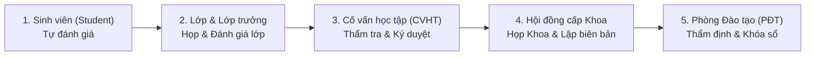
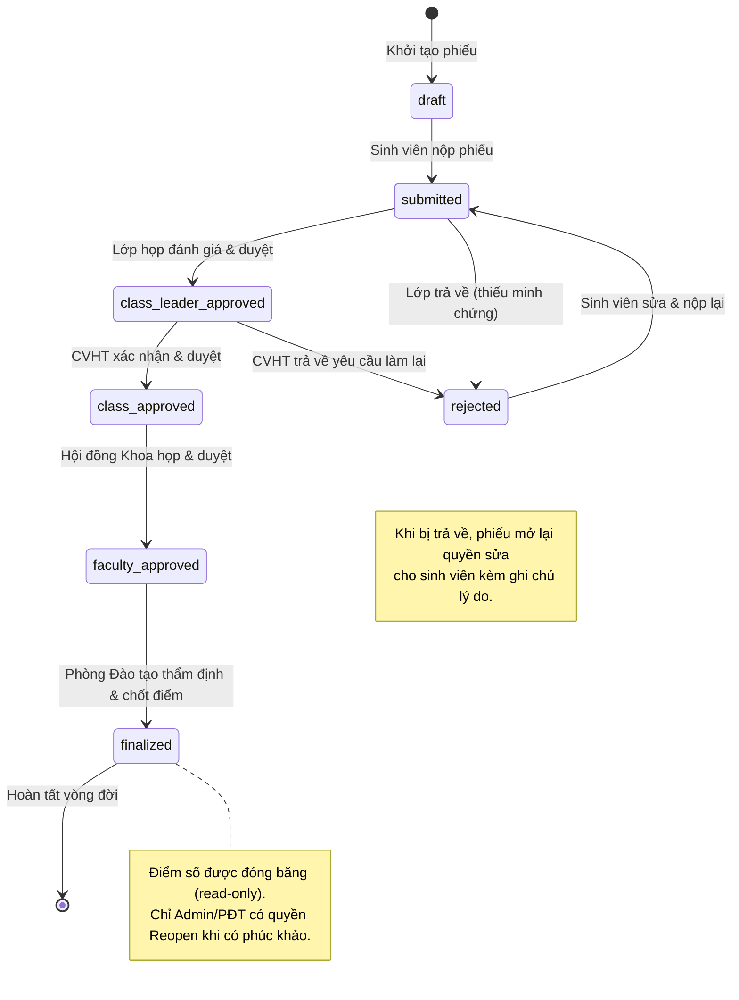

# QUY TRÌNH ĐÁNH GIÁ ĐIỂM RÈN LUYỆN (TỪ SINH VIÊN ĐẾN PHÒNG ĐÀO TẠO)

Tài liệu mô tả chi tiết toàn bộ vòng đời và luồng xử lý phiếu đánh giá điểm rèn luyện trong hệ thống Quản lý Đào tạo & Điểm Rèn luyện (APAG) – Phân hiệu Học viện Hành chính và Quản trị công tại TP. Đà Nẵng.

---

## 1. TỔNG QUAN CÁC CẤP ĐÁNH GIÁ

Hệ thống đánh giá điểm rèn luyện được tổ chức theo mô hình **5 cấp bậc phân quyền (5-Tier Review Process)**:

| Cấp bậc | Chủ thể thực hiện | Vai trò & Trách nhiệm chính | Điểm số ghi nhận |
| :--- | :--- | :--- | :--- |
| **Cấp 1** | **Sinh viên** | Tự chấm điểm theo tiêu chí, tải lên minh chứng, nộp phiếu. | `studentScore` / `selfScore` |
| **Cấp 2** | **Tập thể Lớp / Ban cán sự lớp** | Tổ chức họp lớp, thẩm tra minh chứng, chấm điểm lớp, lập biên bản họp lớp. | `classScore` |
| **Cấp 3** | **Cố vấn học tập (CVHT)** | Giám sát, xem xét tính hợp lệ của buổi họp lớp, xác nhận/điều chỉnh điểm lớp. | Xác nhận `classScore` |
| **Cấp 4** | **Hội đồng cấp Khoa** | Tổ chức họp Hội đồng khoa, chấm điểm khoa, lập biên bản họp khoa từng lớp, xuất báo cáo. | `facultyScore` |
| **Cấp 5** | **Phòng Đào tạo (PĐT)** | Đối soát toàn trường, thẩm tra phúc khảo, chốt điểm rèn luyện chính thức, lưu trữ. | `finalScore` (Điểm PĐT) |

---

## 2. MA TRẬN TRẠNG THÁI PHIẾU (STATE MACHINE)

Vòng đời của phiếu đánh giá được quản lý chặt chẽ qua các trạng thái (`FormStatus`):

### Bảng chuyển đổi trạng thái hợp lệ (`EVALUATION_TRANSITIONS`):

| Hành động | Trạng thái nguồn (`from`) | Trạng thái đích (`target`) | Chủ thể thực hiện |
| :--- | :--- | :--- | :--- |
| **Nộp phiếu** | `draft`, `rejected` | `submitted` | Sinh viên |
| **Lớp duyệt** | `submitted` | `class_leader_approved` | Lớp trưởng / Ban cán sự |
| **CVHT duyệt** | `class_leader_approved` | `class_approved` | Cố vấn học tập |
| **Khoa duyệt** | `class_approved` | `faculty_approved` | Ban Đánh giá cấp Khoa |
| **PĐT duyệt cuối** | `faculty_approved` | `finalized` | Phòng Đào tạo / Ban Giám hiệu |
| **Trả về phiếu** | `submitted`, `class_leader_approved` | `rejected` | Lớp trưởng, CVHT |
| **Mở lại phiếu (Reopen)** | Bất kỳ trạng thái nào | `draft` | Admin / Phòng Đào tạo (Ngoại lệ) |

---

## 3. CHI TIẾT QUY TRÌNH THỰC HIỆN QUA TỪNG BƯỚC

### BƯỚC 1: SINH VIÊN TỰ ĐÁNH GIÁ VÀ NỘP MINH CHỨNG
- **Người thực hiện:** Sinh viên (Role: `student`).
- **Thời gian:** Trong thời hạn nhà trường thông báo mở đợt đánh giá rèn luyện.
- **Thao tác:**
  1. Đăng nhập hệ thống $\rightarrow$ Vào mục **"Phiếu đánh giá"**.
  2. Chọn Học kỳ và Năm học tương ứng.
  3. Hệ thống tải bảng tiêu chí chuẩn (theo Quy chế đánh giá rèn luyện của Học viện).
  4. Sinh viên chấm điểm từng tiêu chí tự đánh giá:
     - Chọn các mức điểm chuyên cần, học tập, ý thức chấp hành pháp quy...
     - Đính kèm file/ảnh minh chứng (giấy khen, chứng nhận tham gia NCKH, hoạt động tình nguyện, cuộc thi...).
  5. Xem trước tổng điểm tự đánh giá (`selfScore`).
  6. Bấm **"Nộp phiếu đánh giá"**:
     - Hệ thống kiểm tra điều kiện hợp lệ và thời hạn nộp (deadline).
     - Trạng thái chuyển từ `draft` $\rightarrow$ `submitted`.
     - Phiếu chuyển sang chế độ **Chỉ xem (View-only)**. Sinh viên không thể tự ý sửa đổi khi đã nộp.
     - Sinh viên chỉ thấy cột **Điểm SV tự đánh giá**, các cột điểm của Lớp/Khoa/PĐT được ẩn đi để đảm bảo tính khách quan trong quá trình chấm.

---

### BƯỚC 2: TẬP THỂ LỚP HỌP ĐÁNH GIÁ (LỚP TRƯỞNG & BAN CÁN SỰ)
- **Người thực hiện:** Lớp trưởng / Ban cán sự lớp (Role: `class_leader`).
- **Thao tác:**
  1. Ban cán sự tổ chức buổi họp lớp đánh giá điểm rèn luyện với sự tham gia của các thành viên trong lớp.
  2. Lớp trưởng đăng nhập $\rightarrow$ Vào mục **"Đánh giá rèn luyện lớp"**:
     - Hiển thị danh sách toàn bộ sinh viên trong lớp kèm trạng thái nộp phiếu (`submitted`, `not_submitted`,...).
  3. Duyệt chi tiết từng sinh viên:
     - Bấm **"Chấm điểm"** để mở bảng đánh giá của sinh viên.
     - So sánh điểm SV tự chấm và xem các file minh chứng đính kèm.
     - Nhập **Điểm lớp đánh giá** (`classScore`) theo kết quả thống nhất tại cuộc họp.
     - Nếu sinh viên chấm khống hoặc thiếu minh chứng: Chọn **"Trả về phiếu"** (`rejected`) kèm ghi chú yêu cầu bổ sung.
  4. Lập **Biên bản họp lớp**:
     - Nhập thành phần tham dự, thời gian, địa điểm, thư ký, danh sách vắng mặt.
     - Hệ thống tự động tổng hợp danh sách điểm và tỷ lệ phân loại (Xuất sắc, Tốt, Khá, Trung bình, Yếu).
     - Xuất file biên bản họp lớp (.docx / .xlsx).
  5. Bấm **"Gửi lên Cố vấn học tập"**:
     - Trạng thái các phiếu trong lớp chuyển sang `class_leader_approved`.

---

### BƯỚC 3: CỐ VẤN HỌC TẬP (CVHT) THẨM TRA & PHÊ DUYỆT
- **Người thực hiện:** Giảng viên Cố vấn học tập (Role: `advisor`).
- **Thao tác:**
  1. Đăng nhập $\rightarrow$ Chọn lớp phụ trách $\rightarrow$ Mở bảng tiến độ **"StudentProgressTable"**.
  2. CVHT xem xét:
     - Biên bản họp lớp và tỷ lệ phân loại của lớp.
     - So sánh điểm sinh viên tự chấm với điểm lớp đã thống nhất.
  3. Trường hợp cần thiết:
     - CVHT có thể điều chỉnh điểm tiêu chí hoặc trả lại phiếu về cho Lớp/Sinh viên rà soát lại nếu biên bản họp chưa hợp lệ.
  4. Khi đồng ý với kết quả:
     - Bấm **"Xác nhận kết quả & Gửi lên Khoa"**.
     - Hệ thống ghi nhận dấu vết `advisorConfirmedAt`, `advisorReviewedAt`.
     - Trạng thái phiếu chuyển từ `class_leader_approved` $\rightarrow$ `class_approved`.

---

### BƯỚC 4: HỘI ĐỒNG ĐÁNH GIÁ CẤP KHOA
- **Người thực hiện:** Trưởng/Phó Khoa, Thư ký Hội đồng Khoa (Role: `faculty`).
- **Giao diện chức năng:** Trang quản lý Khoa (`/faculty` & `/faculty/bien-ban`).
- **Thao tác:**
  1. Hội đồng Khoa họp xét điểm rèn luyện của toàn bộ các lớp trực thuộc Khoa:
     - Hệ thống hiển thị danh sách tất cả các lớp thuộc Khoa kèm sĩ số và tỷ lệ Xuất sắc/Tốt.
  2. Khoa tiến hành đánh giá:
     - Mở chi tiết từng lớp $\rightarrow$ Bảng điểm từng sinh viên.
     - Nhập **Điểm Khoa đánh giá** (`facultyScore`) theo biểu quyết của Hội đồng.
  3. Lập **Biên bản họp Hội đồng Khoa**:
     - Hệ thống hỗ trợ lập biên bản họp khoa cho từng lớp trực thuộc.
     - Tự động thống kê bảng tổng hợp xếp loại: số lượng và phần trăm từng mức (Xuất sắc, Tốt, Khá, TB, Yếu).
     - Xuất Biên bản họp Hội đồng Khoa ra file Word (.docx) và Bảng điểm Excel (.xlsx) để phục vụ lưu trữ, ký tên đóng dấu.
  4. Bấm **"Duyệt & Gửi kết quả lên Phòng Đào tạo"**:
     - Trạng thái phiếu chuyển từ `class_approved` $\rightarrow$ `faculty_approved`.

---

### BƯỚC 5: PHÒNG ĐÀO TẠO (PĐT) THẨM ĐỊNH & KHÓA SỔ
- **Người thực hiện:** Chuyên viên Phòng Đào tạo / Ban Giám hiệu (Role: `training_department` hoặc `admin`).
- **Giao diện chức năng:** Hệ thống phân cấp 3 tầng tại `/training_department/faculty/[facultyId]`:
  - **Tầng 1 (Cấp Khoa):** Thống kê tổng sinh viên toàn khoa, tỷ lệ Xuất sắc/Tốt, nút Xuất Excel toàn Khoa.
  - **Tầng 2 (Danh sách Lớp):** Bảng các lớp thuộc Khoa với mã lớp, tên lớp, sĩ số, tỷ lệ Xuất sắc/Tốt, nút "Xem chi tiết" và nút "Xuất Excel" riêng từng lớp.
  - **Tầng 3 (Bảng điểm chi tiết Sinh viên của Lớp):** Bảng hiển thị đầy đủ 4 cột điểm:
    - *Điểm SV tự đánh giá*
    - *Điểm Lớp đánh giá*
    - *Điểm Khoa đánh giá*
    - *Điểm PĐT đánh giá* (Chốt điểm cuối cùng `finalScore`).
- **Thao tác:**
  1. Phòng Đào tạo kiểm tra, đối soát tính tuân thủ quy chế thi đua khen thưởng của toàn bộ các Khoa.
  2. Thụ lý các đơn khiếu nại, phản ánh hoặc phúc khảo kết quả rèn luyện (nếu có).
  3. Nhập điểm PĐT đánh giá hoặc kế thừa điểm Khoa đã duyệt.
  4. Bấm **"Phê duyệt chính thức / Khóa sổ"**:
     - Trạng thái chuyển từ `faculty_approved` $\rightarrow$ `finalized`.
     - Toàn bộ phiếu đánh giá trong đợt được khóa vĩnh viễn (`isLocked: true`).
     - Điểm số chính thức được đồng bộ sang hồ sơ sinh viên để xét học bổng, thi đua, khen thưởng và cấp bảng điểm tốt nghiệp.

---

## 4. MA TRẬN PHÂN QUYỀN TRUY CẬP (RBAC MATRIX)

| Hành động | Sinh viên | Lớp trưởng | CVHT | Khoa | Phòng Đào tạo | Admin |
| :--- | :---: | :---: | :---: | :---: | :---: | :---: |
| Tự chấm & nộp phiếu cá nhân | **Có** | **Có** (phiếu bản thân) | Không | Không | Không | Không |
| Xem minh chứng sinh viên | Chỉ của mình | Trong lớp | Trong lớp | Trong khoa | Toàn trường | Toàn trường |
| Chấm điểm cấp Lớp (`classScore`) | Không | **Có** | Xem/Chỉnh sửa | Xem | Xem | Xem |
| Lập & xuất Biên bản họp Lớp | Không | **Có** | **Có** | Xem | Xem | Xem |
| Chấm điểm cấp Khoa (`facultyScore`) | Không | Không | Không | **Có** | Xem | Xem |
| Lập & xuất Biên bản họp Khoa | Không | Không | Không | **Có** | Xem | Xem |
| Thẩm tra & chốt điểm PĐT (`finalScore`) | Không | Không | Không | Không | **Có** | **Có** |
| Khóa sổ kết quả (`finalized`) | Không | Không | Không | Không | **Có** | **Có** |
| Mở lại phiếu khiếu nại (`reopen`) | Không | Không | Không | Không | **Có** | **Có** |
| Xuất bảng điểm Excel từng lớp / khoa | Không | Trong lớp | Trong lớp | Trong khoa | Toàn trường | Toàn trường |

---

## 5. CƠ CHẾ AN TOÀN DỮ LIỆU & KIỂM SOÁT ĐỒNG THỜI

1. **Khóa lạc quan & Giao dịch an toàn (Optimistic Locking & DB Transaction):**
   - Các thao tác cập nhật điểm và chuyển trạng thái đều chạy trong Prisma Transaction (`$transaction`).
   - Ngăn chặn race-condition khi thành viên hội đồng đồng thời chấm điểm.

2. **Lưu vết qua từng cấp (Audit Trail):**
   - Hệ thống giữ nguyên vẹn 4 cột điểm qua các cấp: `selfScore` $\rightarrow$ `classScore` $\rightarrow$ `facultyScore` $\rightarrow$ `finalScore`.
   - Giúp việc hậu kiểm, thanh tra và giải quyết khiếu nại diễn ra minh bạch, rõ ràng tại bất kỳ thời điểm nào.

3. **Chính sách khóa dữ liệu (Form Immutability):**
   - Khi đã nộp (`submitted`), sinh viên không thể chỉnh sửa trừ khi được cấp có thẩm quyền trả về (`rejected`).
   - Khi đã khóa sổ (`finalized`), toàn bộ dữ liệu ở mọi cấp đều trở thành chế độ chỉ xem (`read-only`).
