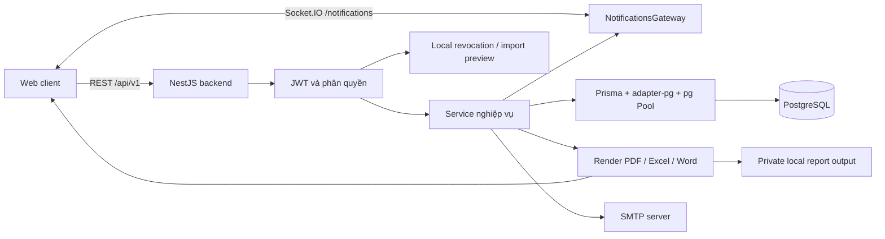
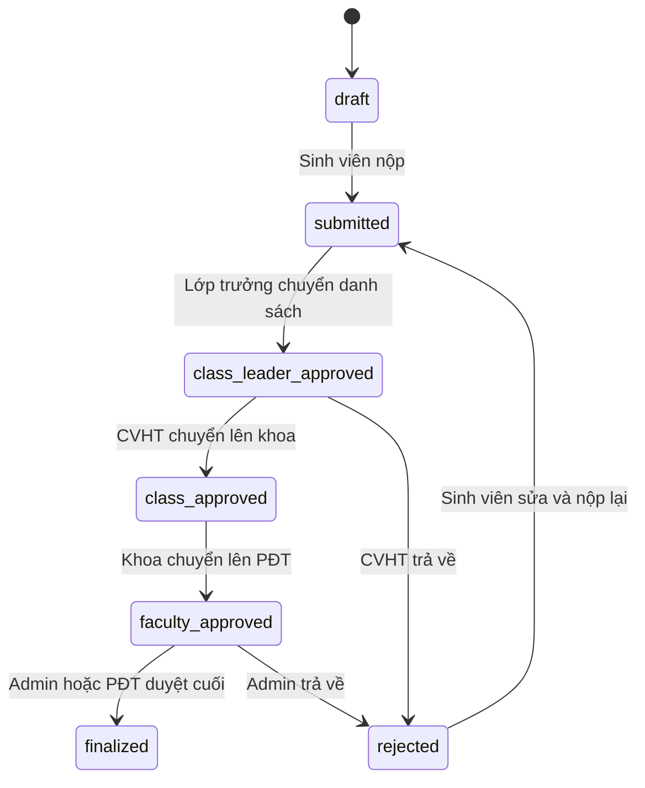

# Kiến trúc hiện tại

Ngày khảo sát: **19/10/2026 (Asia/Ho_Chi_Minh)**. Mã nguồn nền: `4876b15aa63e8b79945aae626bd6fc3b0be53d5b`; mô tả đã cập nhật theo working tree tới rollback infrastructure ngày 23/10/2026.

Tài liệu mô tả backend có trong repository. Các kết luận về production, frontend đang triển khai, reverse proxy, backup và lưu trữ bên ngoài cần được xác minh riêng. README cũ còn mô tả `class_council` và quy trình ba vai trò; tài liệu này lấy controller, service và Prisma schema hiện tại làm nguồn chính.

## 1. Hệ thống đang ở đâu?

CSMTS/SMASTE hiện là **modular monolith**: một ứng dụng NestJS chứa các module nghiệp vụ, REST API và Socket.IO, truy cập chung PostgreSQL qua Prisma. Docker Compose định nghĩa backend và PostgreSQL. Pino, Prometheus và OpenTelemetry vẫn được giữ. Redis/BullMQ đã rollback: Socket.IO local với JWT, SMTP trực tiếp và render export trong HTTP request. Runtime hiện tại dành cho **một API instance**; xem [phạm vi rollback](infrastructure-rollback.md).

SMTP là phụ thuộc ngoài ứng dụng. Minh chứng được API ghi nhận bằng URL; source `EvidencesService` không thực hiện upload hoặc xóa object trên dịch vụ media. Sơ đồ không khẳng định topology frontend hay nhà cung cấp lưu trữ production.

## 2. Thành phần và trách nhiệm

| Nhóm | Module/thành phần | Trách nhiệm hiện tại |
|---|---|---|
| Khởi động | `main.ts`, `AppModule` | Prefix, CORS, validation, response/error wrapper, Swagger |
| Đăng nhập | `AuthModule`, `UsersModule` | Username/password, JWT, refresh token, logout, đổi/quên mật khẩu |
| Hồ sơ | `ProfileModule`, `StudentsModule` | Hồ sơ cá nhân, thông tin sinh viên |
| Danh mục | `AdminFaculties`, `AdminMajors`, `AdminClasses`, `AdminStudents`, `AdminUsers` | Khoa/ngành/lớp/tài khoản, phân công, import Excel |
| Học kỳ | `SemestersModule`, `MetadataModule` | Đợt đánh giá, deadline, dữ liệu combobox |
| Nghiệp vụ chính | `TrainingEvaluationsModule` | Tạo, tự chấm, nộp, xác nhận, chuyển cấp, trả về, phê duyệt |
| Minh chứng | `EvidencesModule` | Gắn URL minh chứng với phiếu và tiêu chí |
| Thông tin | `PostsModule`, `NotificationsModule`, `GatewaysModule` | Bài đăng, notification lưu DB và realtime |
| Báo cáo | `ReportsModule` | Tổng hợp DB, PDF từ kết quả truy vấn, biên bản Excel/Word từ payload |
| Email | `MailModule` | Gửi email tài khoản và đặt lại mật khẩu qua SMTP |
| Dữ liệu | `PrismaModule` toàn cục | Một `PrismaService` và pool trong mỗi tiến trình ứng dụng |

Controller gọi service; một số module danh mục có repository riêng, những service khác gọi Prisma trực tiếp. Chưa có lớp repository thống nhất cho toàn hệ thống.

## Ranh giới module đánh giá sau refactor 20/10/2026

Controller nằm trong `presentation/`; năm application service tách query, ghi điểm, submit, review và finalize. Policy quyền/trạng thái/deadline và công thức điểm ở `domain/`. `EvaluationDeadlinePolicy` áp dụng student/class/facultyDeadline thống nhất trước các lần ghi submit/review/chuyển cấp, quá hạn trả 409; ngày hạn được tính đến cuối ngày Việt Nam. Prisma vẫn được gọi trực tiếp từ application service. State machine tập trung kiểm tra cạnh chuyển trạng thái. Các thao tác ghi điểm/state dùng CAS `id + version`; count bằng 0 trả 409. Chấm kèm xác nhận nay dùng chung transaction; batch conflict rollback toàn bộ. Response trả thêm version. Submit/review/finalize hỗ trợ `Idempotency-Key`: advisory lock và receipt lưu cùng transaction, replay không chạy lại nghiệp vụ. Notification có khóa unique recipient/event để chống trùng. Xem [hướng dẫn đọc code và các điểm tương thích](../projects/src/modules/training-evaluations/README.md).

## 3. Request và phân quyền

1. REST và Socket.IO dùng chung CORS từ `FRONTEND_URL` qua config đã nạp. REST dùng prefix `/api/v1`; Swagger ở `/api/docs`, JSON ở `/api/docs-json`, bật trừ khi `SWAGGER_ENABLED=false`.
2. `ValidationPipe` bật chuyển kiểu, whitelist và từ chối field ngoài DTO.
3. Route bảo vệ dùng `JwtAuthGuard`; `RolesGuard` đọc role được khai báo trên method hoặc controller. Role ở method ghi đè role ở controller.
4. `JwtStrategy` xác minh token, kiểm tra danh sách thu hồi trong RAM và đọc principal hiện tại từ DB mỗi request; role cũ trong JWT không quyết định quyền sau khi DB đã đổi role. Tài khoản inactive/deleted không được tiếp tục dùng token.
5. Evaluation dùng `EvaluationAccessPolicy` với canRead/canEdit/canReview/canSubmitClass/canApproveFaculty/canFinalize. List và detail/summary/status đều giới hạn sở hữu/lớp/khoa; admin/PĐT có phạm vi toàn hệ thống. Service kiểm tra quyền trước workflow; receipt replay kiểm tra lại authorization nhưng không chạy lại transition.
6. REST thông thường trả envelope `success`, `statusCode`, `message`, `data`, `timestamp`, `path`. Route tải file dùng response trực tiếp.

Schema có sáu role: `admin`, `student`, `class_leader`, `advisor`, `faculty`, `training_department`. Quyền thực tế phải đối chiếu từng controller; ví dụ báo cáo tổng hợp hiện khai báo `admin`, trong khi API phê duyệt cuối chấp nhận cả `training_department`.

## 4. Mô hình dữ liệu và vòng đời

| Miền | Quan hệ chính |
|---|---|
| Tổ chức | `Faculty → Major → Class → ClassStudent → User` |
| Phân công | `AdvisorAssignment`, `ClassLeaderAssignment`, `FacultyAssignment` |
| Đánh giá | `User + Semester + Class → EvaluationForm` |
| Chi tiết | `EvaluationForm → FormCriteriaScore / FormAttachment / Evidence` |
| Liên lạc | `User → Notification / PasswordResetToken`; bài đăng qua `Post` |

`ClassStudent.studentId` unique: một hồ sơ lớp cho mỗi sinh viên. `EvaluationForm(studentId, semesterId)` unique: một phiếu mỗi sinh viên mỗi học kỳ. Điểm tự chấm, điểm lớp và điểm cuối được lưu riêng. Các thao tác service tính tổng/xếp loại; các trường reviewer và thời gian ghi lại mốc duyệt, chưa phải nhật ký sự kiện đầy đủ.

Sơ đồ thể hiện đường đi chính; thao tác mở lại và các điều kiện khóa cần xem [luồng API](api-critical-flows.md). `confirm-review` ghi nhận xác nhận từng phiếu, còn chuyển trạng thái cấp lớp diễn ra khi gửi danh sách.

Index khai báo đáng chú ý: phiếu theo `classId`, `(semesterId, status)`, `status`; tiêu chí theo unique `(formId, criteriaId)`; khoa/ngành qua khóa liên kết; notification theo `userId`. Schema không đảm bảo database triển khai đã có toàn bộ index: cần đối chiếu migration/catalog khi tối ưu.

## 5. State trong RAM và hệ quả khi mở rộng

| State | Hiện trạng | Hệ quả |
|---|---|---|
| Access token bị thu hồi | `AuthTokenStoreService`, Map + expiry | Một instance; mất sau restart |
| Profile auth | Đọc DB trực tiếp | Không có cache cần đồng bộ |
| Metadata | TTL 5 phút | Có helper invalidate nhưng chưa thấy caller ngoài khai báo; dữ liệu có thể cũ đến TTL |
| Import preview | Map mã hóa, TTL 10 phút, single claim | Confirm trên cùng instance; mất sau restart |
| Socket.IO room | JWT-derived `user:<id>`, local adapter | Chỉ emit tới socket cùng instance |
| Export registry | Map TTL + local output files | Request chờ render; metadata mất sau restart |

Gateway vẫn xác minh access JWT, local revocation và DB principal trước connection, tự join room theo token. Client không được chọn room của người khác. Xem [runtime hiện tại](infrastructure-rollback.md).

## 6. Kết nối và vận hành

- Backend ưu tiên `DATABASE_URL → DIRECT_URL → DB_*`. Prisma CLI trong `prisma.config.ts` ưu tiên `DIRECT_URL → DATABASE_URL → DB_*`. Hai đường kết nối có thể khác nhau.
- Nest đọc `projects/.env` theo vị trí `src/` hoặc `dist/`, CLI nạp `.env` cạnh `prisma.config.ts`; biến môi trường của process được ưu tiên. Service đọc qua `ConfigService`; port, boolean, URL và thời hạn JWT được validate lúc startup.
- `PrismaService` đặt pool rõ: max 10, idle timeout 30s, acquisition/connection timeout 2s; đổi bằng `DB_POOL_MAX`, `DB_POOL_IDLE_TIMEOUT`, `DB_POOL_CONNECTION_TIMEOUT`. Worker đã rollback; chỉ tính pool API và client/job khác hiện có. Metrics đọc total/idle/waiting và checkout duration từ pool thực; tính ngân sách pool cho topology thực tế; runtime local hiện chỉ hỗ trợ một API instance. Xem [số đo Phase 7](database-performance.md).
- `PRISMA_CONNECT_ON_INIT` mặc định `true`; khi bật, startup gọi connect và `SELECT 1`. `/api/v1/health` chỉ trả trạng thái tĩnh, không xác nhận DB đang hoạt động tại thời điểm request.
- `main.ts` bind theo `BACKEND_HOST` (mặc định `0.0.0.0`) và `BACKEND_PORT` (5050). Nest Logger theo `LOG_LEVEL`, bỏ timer/console debug trùng lặp, timing import chỉ ở debug. Shutdown hooks dọn Prisma/pool khi dừng.
- Compose dùng PostgreSQL 17, named volume, healthcheck `pg_isready`; cổng DB host mặc định 15432, còn backend trong mạng Compose dùng `db:5432`.
- Docker build dùng Node 22; máy đo hiện tại dùng Node 24. Production khởi động bằng `pnpm start:prod`, chạy migration deploy rồi mới chạy `dist/main.js`.
- Chưa thấy reverse proxy/TLS, orchestration, policy backup/restore, alert hoặc CI trong repository khảo sát. Chưa xác minh những thành phần có thể được vận hành bên ngoài repo.

## 7. Điểm cần đo trước khi thay đổi

Phase 7 đã capture SQL thật và EXPLAIN ANALYZE/BUFFERS cho listing, admin, report, notification và search; chọn hai index timeline từ số đo. Query trang sâu vẫn có chi phí OFFSET; export toàn bộ vẫn đọc/map toàn bộ rows trong request export. Export lớn hiện render ngay trong POST /reports/exports; route export-pdf đồng bộ vẫn giới hạn 500 rows. Email gửi trực tiếp sau commit. Tiếp tục đo transaction/concurrency/CPU khi tải và số replica thay đổi. Xem [chi tiết và giới hạn](database-performance.md).

Quy ước env ở [environment.md](environment.md), topology và cách triển khai ở [deployment.md](deployment.md). Xem [baseline](performance-baseline.md) và [roadmap](scaling-roadmap.md) để biết dữ liệu đã có và điều kiện quyết định tối ưu.

## Nguồn kiểm chứng

- [Bootstrap](../projects/src/main.ts), [module gốc](../projects/src/app.module.ts), [PrismaService](../projects/src/database/prisma.service.ts).
- [Schema](../projects/prisma/schema/schema.prisma), [migrations](../projects/prisma/schema/migrations).
- [JWT strategy](../projects/src/modules/auth/strategies/jwt.strategy.ts), [token store](../projects/src/modules/auth/jwt/auth-token-store.ts), [auth service](../projects/src/modules/auth/auth.service.ts).
- [Metadata cache](../projects/src/modules/metadata/helpers/metadata-cache.helper.ts), [import](../projects/src/modules/admin-classes/admin-classes.service.ts), [gateway](../projects/src/modules/gateways/notifications.gateway.ts).
- [Compose](../projects/docker-compose.yml), [Dockerfile](../projects/Dockerfile), [scripts](../projects/package.json), [Prisma CLI config](../projects/prisma.config.ts).

## Database invariants (20/10/2026)

Đã audit unique constraint và bổ sung validation/race handling trong application. Migration bổ sung unique username sau chuẩn hóa và partial unique index cho tối đa một kỳ active đã áp dụng vào local ngày 20/10/2026 sau khi người dùng chọn đóng HK1, giữ HK2 năm học 2025–2026 active. Đã xác minh hai index mới và audit không có dữ liệu vi phạm; chưa rollout staging/production. Xem [ma trận invariant, audit và điều kiện deploy](database-business-invariants.md).

## Cập nhật observability — 20/10/2026

Phase 2 bổ sung module `projects/src/observability/`: Pino JSON, request/correlation context, OpenMetrics và OpenTelemetry HTTP → NestJS → Prisma → PostgreSQL. HTTP/SMTP dependency và Socket.IO đã có instrumentation. Stack tools và dashboard được chuẩn bị, chưa xác minh container runtime. Xem [Observability và runbook](observability.md).

## Rollback infrastructure — 23/10/2026

Gỡ Redis shared state, Socket.IO Redis adapter và BullMQ/worker. Giữ JWT socket, nghiệp vụ Phase 1, logging/metrics/tracing và cấu hình pool/index Phase 7. Dữ liệu/schema/migration PostgreSQL không đổi. Các benchmark nhiều instance trước đây là lịch sử, không chứng minh capacity của runtime vừa rollback. Xem [runbook](infrastructure-rollback.md).
