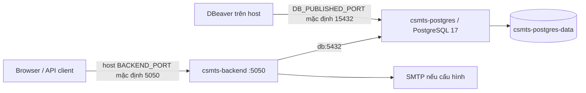

# Deployment hiện tại

Cập nhật 19/10/2026. Tài liệu ghi cấu hình trong repository và những quan sát local đã thực hiện. Chưa có thông tin xác minh về máy chủ production, domain/API public, reverse proxy/TLS, CI/CD, replica hoặc backup thực tế.

## 1. Các cách chạy hiện có

| Cách chạy | Entry point | Đặc điểm |
|---|---|---|
| Local dev | `pnpm dev` trong `projects/` | Nest watch, dùng `projects/.env` |
| Local một lần | `pnpm dev:once` | ts-node, không watch |
| Build production | `pnpm build` | Generate Prisma, tsc, tsc-alias, copy assets |
| Start production | `pnpm start:prod` | `prisma migrate deploy`, sau đó `node dist/main.js` |
| Compose | `docker compose up -d --build` | Một backend Node và một PostgreSQL cùng host |

Local đã quan sát database `apag` ở `localhost:5432`, PostgreSQL 17.9 và API health port 5050. Việc này không xác nhận production dùng cùng endpoint hay phiên bản. Bản [baseline](performance-baseline.md) giữ nguyên số đo trước đợt chuẩn hóa env/log.

Lần kiểm tra local sau chuẩn hóa thấy một process Node listen tại `127.0.0.1:5050`, working directory `projects/`. `docker compose ps` không trả container đang chạy của project này tại thời điểm kiểm tra. Vì vậy Compose dưới đây là cấu hình deployment có sẵn trong repo, chưa phải bằng chứng hệ thống local đang chạy bằng Docker.

## 2. Dockerfile và Compose



- Dockerfile nhiều stage: `base → deps → build → runner`, dùng `node:22-bookworm-slim`. Cài dependency bằng frozen lockfile. Runner hiện copy toàn bộ `node_modules` từ build, chưa tách production dependencies.
- Compose đặt container name `csmts-backend` và `csmts-postgres`, policy `unless-stopped`. Đây là topology một backend; tên cố định chưa phù hợp mở nhiều replica bằng Compose scale.
- PostgreSQL dùng `postgres:17-bookworm`, volume `/var/lib/postgresql/data`, init scripts read-only từ `infra/postgres/init`. Init scripts chỉ chạy khi database directory còn trống.
- Backend đợi DB healthy bằng `pg_isready`; sau đó `start:prod` chạy migration trước khi phục vụ HTTP. `pg_isready` không thay thế kiểm tra credential bằng query thật của ứng dụng.
- Backend bind `0.0.0.0:5050` trong container. Port host được ánh xạ `${BACKEND_PORT:-5050}:5050`; database ánh xạ `${DB_PUBLISHED_PORT:-15432}:5432`.
- Container backend dùng `DB_HOST=db`, port 5432 và các biến DB rời. URL được code ghép và encode password, tránh ghép credential thô trong YAML.
- Chưa có backend healthcheck trong Compose. Endpoint `/api/v1/health` là liveness tĩnh, chưa phải readiness DB.
- Shutdown hooks được bật để Nest gọi hook dọn Prisma/pool khi nhận signal dừng.

## 3. Chạy local

Điền `.env` theo [environment.md](environment.md), chọn đúng PostgreSQL local hoặc Docker.

```bash
cd /Users/nguyenson/APAG_BE/projects
pnpm install --frozen-lockfile
pnpm db:generate
pnpm dev
```

Nếu chỉ DB chạy trong Docker, khởi động service `db`; backend trên host phải dùng `localhost:15432` theo port mặc định Compose. Nếu cả backend và DB chạy trong Compose, backend dùng `db:5432`. PostgreSQL cài trực tiếp trên máy thường dùng 5432; cần xác nhận bằng cấu hình thực tế.

Không chạy seed hoặc migration chỉ để kiểm tra kết nối. Migration và seed là bước thay đổi dữ liệu, phải chọn đúng môi trường trước khi chạy.

## 4. Triển khai bằng Compose

Điền các secret bắt buộc `DB_PASS`, `JWT_ACCESS_SECRET`, `JWT_REFRESH_SECRET`; frontend origin và URL trong email phải đúng môi trường. Compose kiểm tra thiếu secret ngay lúc dựng cấu hình. SMTP là tùy chọn. Với production, cân nhắc `SWAGGER_ENABLED=false` và giữ `LOG_LEVEL=info`.

```bash
cd /Users/nguyenson/APAG_BE/projects
docker compose config --quiet
docker compose up -d --build
docker compose ps
curl --fail http://127.0.0.1:5050/api/v1/health
```

Đổi cổng trong lệnh curl nếu `BACKEND_PORT` khác 5050. Xem lỗi bằng `docker compose logs --tail=100 backend`; không xuất toàn bộ environment hay URL có credential vào log/ticket.

Lần khởi động production có thể áp dụng migration. Trước triển khai cần xác nhận target DB, backup và khả năng phục hồi phù hợp môi trường. Những lệnh trên mô tả quy trình; đợt chuẩn hóa này không chạy `compose up`, không deploy production và không áp dụng migration.

## 5. Kiểm tra sau thay đổi cấu hình

| Kiểm tra | Mong đợi |
|---|---|
| Biến thiếu/sai kiểu | Startup báo tên biến; không in giá trị credential |
| `BACKEND_HOST`/port | Bind đúng cấu hình; Compose vẫn dùng 5050 nội bộ |
| CORS HTTP/Socket.IO | Dùng chung danh sách `FRONTEND_URL` đã nạp |
| `SWAGGER_ENABLED=false` | Docs và docs-json không được đăng ký |
| `LOG_LEVEL=info` | Không có timing debug import, vẫn có log lỗi và startup cần thiết |
| `PRISMA_CONNECT_ON_INIT=true` | Startup xác thực DB bằng query trước khi listen |
| SMTP tắt | App vẫn khởi động; tác vụ cần gửi email được xử lý theo service hiện tại |

## 6. Những phần chưa xác minh ngoài repository

| Hạng mục | Trạng thái cần bổ sung từ vận hành |
|---|---|
| Host/cloud, vùng, CPU/RAM/volume | Chưa có thông tin |
| Domain API/frontend, TLS, ingress | Chưa kiểm chứng; không suy luận từ URL cũ trong source |
| Release/image tag/digest, CI/CD | Chưa có pipeline được xác minh |
| Nguồn secret và rotation | `.env` là cơ chế local; production chưa xác minh |
| Backup, retention, RPO/RTO, restore | Chưa có bằng chứng thực hiện |
| Monitoring và cảnh báo | Chưa thấy cấu hình tập trung trong repo |

Không dùng named volume như bằng chứng đã có backup. Rollback app không tự rollback migration: đánh giá tương thích schema và phục hồi dữ liệu trước khi đổi phiên bản. Không xóa volume để xử lý sai password.

Các điều kiện mở nhiều instance, shared state, migration coordination và connection budget được ghi ở [scaling-roadmap.md](scaling-roadmap.md).

Nguồn: [Dockerfile](../projects/Dockerfile), [Compose](../projects/docker-compose.yml), [package scripts](../projects/package.json), [bootstrap](../projects/src/main.ts), [PrismaService](../projects/src/database/prisma.service.ts).

## Migration concurrency ngày 20/10/2026

Đã áp dụng migration `20261020010000_add_evaluation_form_version` trên PostgreSQL local `apag`: thêm cột `version INTEGER NOT NULL DEFAULT 0`. Điểm và trạng thái hiện có được giữ nguyên. Môi trường khác phải chạy `pnpm db:deploy` trước khi chạy code/client mới; chưa triển khai production. Test concurrency dùng schema tạm riêng và không ghi các record nghiệp vụ trong public.

## Migration idempotency và business invariants ngày 20/10/2026

DB local `apag` cũng đã áp dụng `20261020020000_add_idempotent_operations` và `20261020030000_enforce_business_invariants`. Migration thứ hai được chạy sau khi người dùng chọn đóng HK1 năm học 2025–2026, giữ HK2 active. Đã xác minh receipt/notification migration hoàn tất, unique index username chuẩn hóa và single active semester tồn tại; audit sau áp dụng không có dữ liệu vi phạm. Đây là thay đổi local, chưa triển khai staging/production. Xem [báo cáo Phase 1](phase-1-refactor-report.md) và [điều kiện deploy business invariants](database-business-invariants.md).

## Cập nhật observability — 20/10/2026

Có standalone Compose tại `projects/infra/observability/compose.yml` cho Prometheus, Grafana, Tempo và OTel Collector, không chạy migration/backend/DB. Container runtime chưa được xác minh trên máy này. Backend production cần `METRICS_TOKEN` hoặc `METRICS_ENABLED=false` trước khi khởi động bản mới. Xem [Observability và runbook](observability.md).

## Redis/shared state — 21/10/2026

Compose chính thêm Redis private service với AOF appendfsync always/noeviction, volume và healthcheck; backend đợi Redis healthy. Standalone local Compose ở projects/infra/redis/compose.yml. Native Redis loopback đã được chạy/test; container runtime chưa xác minh. Xem [runbook và kết quả kiểm thử](redis-stateless-api.md).

## Realtime nhiều instance — Phase 5

Socket.IO xác thực access JWT ở handshake, tự join room của user và dùng Redis Pub/Sub adapter để broadcast xuyên API. FE gửi `auth.token`, dùng websocket-only. Polling client cần sticky session tại load balancer. Xem [contract, kiểm thử và vận hành](realtime-multi-instance.md).

## Phase 6 — BullMQ worker

Email/report consumer chạy bằng process riêng (`cd projects && pnpm worker:dev`); production Compose có service worker. Scrape cả API:5050 và worker:5051 bằng METRICS_TOKEN; shared report volume bắt buộc giữa API và worker. Retry/backoff/retention, env mới và download owner checks mô tả tại [async processing runbook](async-processing.md).

## Phase 7 — PostgreSQL pool và index

API mặc định `DB_POOL_MAX=10`, worker Compose `WORKER_DB_POOL_MAX=3`, idle 30000ms, checkout/connection 2000ms. Native worker phải đặt pool riêng trong environment. Tính tổng connection của mọi replica, job và rollout overlap trước khi tăng số instance. Hai migration index mới dùng CONCURRENTLY, mỗi migration một statement; đã kiểm chứng trên clone synthetic, chưa deploy vào APAG. Xem [ngân sách, before/after và rollout](database-performance.md).
