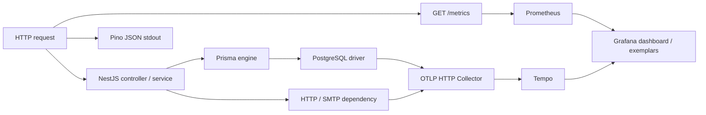

# Phase 2 — Observability

Cập nhật 20/10/2026. Đã triển khai trong backend; stack Prometheus/Grafana/Tempo/Collector đã có cấu hình và dashboard, **chưa xác minh chạy container trên máy này**. Không thay schema hoặc dữ liệu nghiệp vụ trong phase này.

## 1. Những gì thay đổi

`projects/src/observability/` tập trung logging, metrics và tracing. `main.ts` nạp OpenTelemetry trước NestJS, HTTP, Prisma và driver `pg`; sau đó gắn middleware đo request trước CORS/body parser. Nest Logger hiện có được chuyển qua Pino JSON.

Luồng chẩn đoán:



Prisma và PostgreSQL được instrument đồng thời: một trace thể hiện thời gian framework, Prisma và roundtrip driver. Không dùng SQL comment hoặc `SET application_name` cho mỗi query. Metric DB đo trực tiếp pool/driver nên vẫn hoạt động khi tracing tắt hoặc trace không được sample.

## 2. Structured logging và correlation

Mỗi request nhận `X-Request-ID` và `X-Correlation-ID` trong response. UUID hoặc chuỗi hex 32 ký tự hợp lệ từ caller được giữ; giá trị khác được thay mới. Correlation ID mặc định bằng request ID. Các header này dùng để truy vết, không dùng làm danh tính hay quyền truy cập.

Log hoàn tất request chứa `method`, `path` theo route template, `status`, `durationMs`, hai ID và `userId`/`role` khi guard đã xác thực. Ví dụ dạng dữ liệu (ID minh họa):

```json
{"level":30,"service":"apag-backend","event":"http.request","method":"GET","path":"/api/v1/users/me","status":200,"durationMs":24.7,"requestId":"98bbe401-6a15-4a61-a52c-7d9281547079","correlationId":"98bbe401-6a15-4a61-a52c-7d9281547079","userId":"example-user","role":"student","traceSampled":true}
```

Khi tracing bật, log thêm `traceId`, `spanId`, `traceSampled`. `traceSampled=false` nghĩa là không kỳ vọng tìm được trace tương ứng trong Tempo. AsyncLocalStorage và OTel context giữ correlation xuyên các lời gọi service/Prisma; log chậm DB giữ ID của request khởi tạo query.

- Request lỗi guard, malformed JSON, 404 và CORS preflight vẫn được đo. Kết nối bị ngắt trước khi gửi xong được ghi status nội bộ 499, một lần duy nhất.
- Route không khớp dùng `unmatched`; không ghi URL query string hoặc ID động thành metric label.
- Không serialize request/response body, authorization header, cookie, SQL, parameters, password, JWT, refresh token hoặc SMTP secret. Logger có redaction theo key và lọc chuỗi chứa credential/URL/giá trị secret trong env.
- Error chỉ giữ loại lỗi và mã an toàn, không ghi raw driver message/stack. Các SMTP catch đã bỏ nội suy raw error. Khi cần điều tra, dùng mã lỗi + request/trace ID.
- HTTP/Undici outgoing được gắn hai header correlation và W3C trace context khi tracing bật.
- Chưa có queue trong ứng dụng hiện tại. `captureJobContext()` và `observeJob()` chuẩn bị cho producer/consumer sau này; carrier chỉ chứa correlation và W3C context, không chứa actor/JWT/payload. Không có background worker mới được tạo trong phase này.

## 3. Cấu hình

| Biến | Mặc định | Ý nghĩa |
|---|---|---|
| `LOG_LEVEL` | `info` | `error`, `warn`, `info`, `debug`, `verbose` (verbose ánh xạ Pino trace) |
| `METRICS_ENABLED` | `true` | `false` khiến `/metrics` trả 404 |
| `METRICS_TOKEN` | trống | Bearer riêng cho scraper; khi đặt phải >=32 ký tự, không whitespace |
| `OTEL_ENABLED` | `false` | Bật SDK/export trace; restart backend sau khi đổi |
| `OTEL_SERVICE_NAME` | `apag-backend` | Tên service trong log, metric và trace |
| `OTEL_EXPORTER_OTLP_TRACES_ENDPOINT` | `http://127.0.0.1:4318/v1/traces` | OTLP HTTP endpoint; không chứa credential/query |
| `OTEL_TRACES_SAMPLER_ARG` | `0.1` | Tỷ lệ sample root trace, 0..1; giữ quyết định sampling từ parent |
| `DB_SLOW_QUERY_MS` | `500` | Ngưỡng warning/counter query chậm, tính bằng ms |

Production bật metrics bắt buộc có `METRICS_TOKEN`, hoặc cấu hình `METRICS_ENABLED=false`. Development không có token chỉ cho phép socket loopback thật; không tin `X-Forwarded-For`. Prometheus chạy trong Docker cần token. Token này độc lập với JWT access/refresh secrets.

`GET /metrics` không có prefix `/api/v1`, trả OpenMetrics trực tiếp, không nằm trong JSON response envelope. Không ghi request log/trace cho scrape để giảm nhiễu. Metrics vẫn hoạt động khi OTel tắt.

SDK export theo batch, queue tối đa 2048 span/process, timeout export hữu hạn. Collector có memory limiter và queue hữu hạn. Mất collector không làm request nghiệp vụ chờ export, nhưng trace có thể bị mất khi đầy queue; `tracing_enabled=1` chỉ xác nhận cấu hình SDK, không chứng minh collector khỏe.

## 4. Metrics và dashboard

Dùng `@prometheus-io/client`, thư viện kế nhiệm được duy trì trong tổ chức Prometheus. Metrics có label `service`; Prometheus thêm `job` và `instance`.

| Metric | Đơn vị / labels / cách hiểu |
|---|---|
| `http_requests_total` | Counter; `method,path,status` |
| `http_request_duration_seconds` | Histogram giây; cùng labels; sampled trace ID ở exemplar |
| `http_errors_total` | Counter response >=400, gồm cả 401/403/409; cùng labels |
| `process_cpu_usage` | CPU core tiêu thụ giữa hai lần scrape; 1 = một core đầy tải |
| `process_memory_usage` | RSS bytes của process backend |
| `event_loop_lag` | Mean delay giây giữa hai scrape, resolution 20ms; không phải giá trị 0 lý tưởng |
| `db_pool_total`, `db_pool_idle`, `db_pool_waiting` | Số connection/request thực từ pool `pg`; label `pool` |
| `db_pool_acquire_duration_seconds` | Histogram giây chờ checkout connection |
| `db_query_duration_seconds` | Histogram roundtrip query, `operation,status`; exemplar trace ID |
| `db_slow_queries_total` | Counter vượt ngưỡng; `operation`, không có SQL text |
| `active_websocket_connections` | Socket.IO connection đang mở ở notifications namespace của process |
| `queue_jobs_waiting`, `queue_jobs_failed` | Snapshot queue; failed là số job lỗi còn được backend giữ, không phải counter |
| `queue_job_duration` | Histogram **giây**, `queue,status` |
| `queue_enabled` | 1 khi adapter queue đọc được snapshot; 0 nếu không có queue hoặc backend lỗi |
| `tracing_enabled` | 1 khi process được cấu hình bật tracing |

Hiện `queue="none"` có giá trị 0 để nói rõ chưa có queue. Khi tích hợp queue thật, gọi `registerQueue()` với snapshot và bọc worker bằng `observeJob()`. Adapter lỗi giữ depth cuối cùng và đặt `queue_enabled=0`, không báo giả queue rỗng. Tên queue phải cố định, không lấy từ user input. Metric labels không có user ID, request ID hay trace ID; trace ID chỉ là exemplar để tránh cardinality tăng theo request.

Dashboard `projects/infra/observability/grafana/dashboards/apag-api.json` có 20 panel: RPS, p50/p95/p99, tỷ lệ 5xx, lỗi theo status, CPU, RSS, event loop, DB total/idle/waiting, checkout p95, query p95, slow query rate, WebSocket, queue depth/failed/job p95, trạng thái queue/tracing và scrape up. Có bộ lọc service/instance/route và datasource Prometheus/Tempo được provision sẵn.

Percentile dùng `histogram_quantile` sau khi cộng bucket, không lấy trung bình percentile giữa instance. Error rate panel là 5xx / tổng request; panel lỗi riêng vẫn hiện 4xx. Các panel CPU/DB/queue là toàn process, không phân rã theo route. Không có traffic thì một số panel rate/percentile có thể chưa có dữ liệu.

## 5. Chạy stack local

Từ `projects/`, trong cùng terminal dùng chạy backend và Compose, chuẩn bị secret riêng. Không đưa secret vào Git:

```bash
export METRICS_TOKEN="$(openssl rand -hex 32)"
export GRAFANA_ADMIN_PASSWORD="$(openssl rand -hex 24)"
export OTEL_ENABLED=true
export OTEL_EXPORTER_OTLP_TRACES_ENDPOINT=http://127.0.0.1:4318/v1/traces
export OTEL_TRACES_SAMPLER_ARG=0.1

docker compose -f infra/observability/compose.yml config --quiet
docker compose -f infra/observability/compose.yml up -d
pnpm dev:once
```

Compose secret đọc `METRICS_TOKEN` từ environment, và backend phải dùng **cùng token**. Sinh lại Grafana password không tự đổi password của database Grafana đã có trong volume. Nếu mở terminal khác, cấp lại cùng các giá trị từ secret store. Không chạy thêm backend nếu port đang được dùng; restart process hiện tại với env mới.

Sau khi stack chạy: Grafana `http://localhost:3300` (user `admin`), Prometheus `http://localhost:9090`, Tempo `http://localhost:3200`; collector nhận tại loopback 4318. Dashboard có tên **APAG — API Observability**. Datasource Prometheus có exemplar `traceId` liên kết đến Tempo.

Prometheus mặc định scrape `host.docker.internal:5050/metrics`. Backend chạy trên host phải bind địa chỉ mà container truy cập được (`BACKEND_HOST=0.0.0.0` nếu cần), có metrics token và firewall phù hợp. Nếu dùng port khác, sửa target trong `prometheus.yml`. Nếu backend chạy Compose khác, điều chỉnh network/target; không dùng `localhost` của container để chỉ host. Backend Compose hiện có exporter endpoint `host.docker.internal:4318/v1/traces`; cấp `METRICS_TOKEN` qua env của service.

Kiểm tra sau khi khởi động:

```bash
curl -fsS -H "Authorization: Bearer $METRICS_TOKEN" http://localhost:5050/metrics
curl -fsS http://localhost:9090/-/ready
curl -fsS http://localhost:3200/ready
curl -fsS http://localhost:3300/api/health
docker compose -f infra/observability/compose.yml ps
```

Các cổng công cụ Compose chỉ publish loopback. Stack có named volumes: Prometheus giữ 7 ngày, Tempo 24 giờ; đây là cấu hình local, chưa phải kế hoạch lưu trữ/HA/backup production. File Compose không khởi tạo backend, không chạy migration và không đụng DB nghiệp vụ.

## 6. Runbook: một API đang chậm

1. Chọn service/instance/route, thời gian incident. Xem RPS, p95/p99, 5xx và `up` để phân biệt ít dữ liệu với service mất kết nối.
2. Lấy `X-Request-ID` từ response hoặc tìm log `http.request`; ghi `durationMs`, `traceId`, `traceSampled`. Mở trace qua exemplar hoặc Tempo Explore.
3. Trong trace đi từ HTTP/Nest đến Prisma/PG hoặc HTTP/SMTP child span. Dùng bảng dưới để xác định giả thuyết rồi kiểm chứng ở cùng khoảng thời gian.

| Quan sát | Hướng điều tra |
|---|---|
| CPU/core và event loop tăng; DB/external spans ngắn | Application CPU: JSON/Excel/PDF, vòng lặp đồng bộ, validation lớn; dùng CPU profile cho bước xác nhận |
| Pool waiting và checkout p95 tăng; query roundtrip không tăng tương ứng | Chờ connection: pool budget, transaction dài/giữ connection, nhiều replica tranh DB |
| PostgreSQL roundtrip dài và slow counter tăng | DB: lock, query plan/index, I/O. Tra cứu query từ code/DB diagnostics được cấp quyền; telemetry không chứa SQL |
| HTTP/SMTP child span dài, CPU thấp | Dependency: mạng, DNS, server phía ngoài, timeout; xem `server.address` và thời gian span |
| Nest/app span dài, child spans ngắn, CPU thấp | Thời gian chờ trong application chưa có span: thêm span quanh bước nghiệp vụ cụ thể |

Span `prisma:engine:connection` và metric checkout giúp nhận diện phần chờ trước query; PG span phản ánh roundtrip network + PostgreSQL, không tự phân biệt lock/CPU DB. Không cộng đơn giản duration của child span chạy song song. CPU/memory metric ở đây là **Node process**, không phải CPU PostgreSQL/host; muốn xác nhận nguyên nhân bên trong DB cần PostgreSQL diagnostics/exporter bổ sung.

Nếu không có trace: kiểm tra `OTEL_ENABLED`, sampling, collector/exporter endpoint và trạng thái Tempo. Có thể đặt sampling 1 trong một cửa sổ debug có kiểm soát rồi restart, tái hiện request, sau đó trả tỷ lệ về bình thường. Log và metric không phụ thuộc trace sampling. Không bật log body/SQL/password để tìm bottleneck.

## 7. Kiểm chứng và giới hạn

- `pnpm test:observability`: HTTP integration và probe chạy ở process riêng để bảo đảm instrumentation load trước thư viện. Dùng `TEST_DATABASE_URL` nếu muốn chỉ định DB; mặc định đọc env backend.
- Probe chỉ SELECT trên DB local, gọi HTTP server và SMTP sink loopback, không gửi email ra ngoài. Tạo query trễ ~40ms và dependency trễ ~25ms để kiểm tra phân biệt span; kiểm tra W3C/correlation headers, raw metrics, exemplar, mã 403/500 và chuỗi canary chứa SQL/secret không lọt log/trace.
- Probe đã thu 46 span gồm HTTP, Express, NestJS, Prisma, PostgreSQL, Undici, SMTP và job context. Đây là smoke test, không phải benchmark tải hoặc baseline production.
- Unit tests kiểm tra redaction, context isolation, metrics/socket/pool, queue snapshot failure và metrics authorization. Regression Phase 1 vẫn phải chạy sau thay đổi pool/dependency.
- Docker Compose đã qua kiểm tra cấu hình; dashboard JSON có sẵn. Docker daemon trên máy chưa hoạt động và quyền điều khiển Docker UI chưa được cấp, nên chưa xác nhận container startup, Prometheus scrape, Tempo ingestion và dashboard live. Chưa thể tuyên bố DoD vận hành end-to-end hoàn tất trước khi kiểm chứng stack này.

Nguồn kỹ thuật: [OpenTelemetry JS instrumentation](https://opentelemetry.io/docs/languages/js/libraries/), [Prisma tracing](https://docs.prisma.io/docs/orm/prisma-client/observability-and-logging/opentelemetry-tracing), [Prometheus JS client](https://github.com/prometheus/client_js), [Pino redaction](https://github.com/pinojs/pino/blob/main/docs/redaction.md).

## Runtime sau rollback — 23/10/2026

Không còn worker/BullMQ. Prometheus scrape API:5050; queue=none và queue_enabled=0 là trạng thái mong đợi. Pino, request/correlation IDs, DB pool/query metrics, WebSocket count và OTel vẫn giữ. Chạy `pnpm test:local-infrastructure` để kiểm tra runtime không cần Redis và `pnpm test:observability` để kiểm tra telemetry. Xem [rollback runbook](infrastructure-rollback.md).
